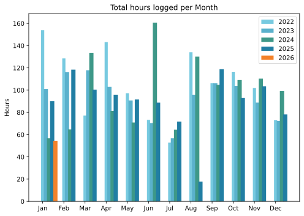
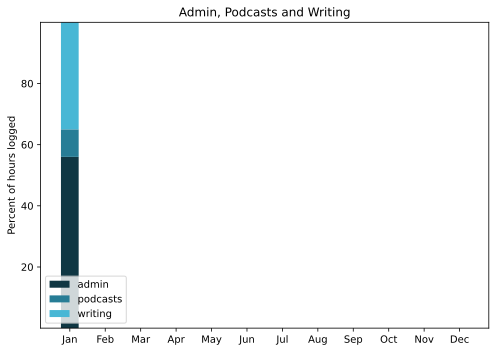

Late because recovering my full WithKnown installation took priority. Also, it was a pretty uneventful month.

===

## Highlights of the month:
- Splendid unforeseen rest sitting with our favourite cat
- Rereading Lord of the Rings (for the first time!)
- Good start on moving web hosting
- Fell for a phishing scam (for the first time!)
- Another damnable spambot attack
- Qigong continues well
- Finalised a crochet hat for a friend
- Air fryer on balance not awful.

### Activities

#### January: 
* Walking with sticks: 0
* Reading: 28
* Steps (avge): 7047
* Podcasts: 16 (all of them [logged](https://www.jeremycherfas.net/listens))
* In bed/asleep 8:19/8:10
* Cycled: 0
* Weight (avge): 89.6
* Naps: 23

#### December: 
* Walking with sticks: 0
* Reading: 6
* Steps (avge): 8344
* Podcasts: 17 (16 of them [logged](https://www.jeremycherfas.net/listens))
* In bed/asleep 8:13/8:05
* Cycled: 3 days
* Weight (avge): 90.8
* Naps: 12

### Stuff Done

Moving as much of my hosting over to Hetzner as I can, about which I will have more to say when it is done. For now, my primary observation is that there are good bits and not so good bits.

#### Hours logged per month

#### Percent of logged hours

Previous years are still on [an archive page](https://jeremycherfas.net/blog/working-life).

### Goals

Nine blog posts, and I shouldn't complain, but too many of them are geeky notes about things that went wrong and sometimes how to fix them.

### Niggles

Hosting is hard.

### Final remarks

I'll be glad when everything is just purring smoothly as it mostly was before. Yes, I brought this misery on myself, and also yes I know it will be better in the long run.

----

## Here’s the table

Click the triangle to see or hide the table

<table class="worktable">
<thead>
<tr>
<th style="text-align: right;" class="bigrow">Month</th>
<th style="text-align: center;" class="bigrow">Total</th>
<th style="text-align: center;" class="smallrow">Daily</th>
<th style="text-align: center;"class="smallrow">Admin %</th>
<th style="text-align: center;"class="smallrow">ETP %</th>
<th style="text-align: center;"class="smallrow">Writing %</th>
<th style="text-align: center;"class="smallrow">Other %</th>
</tr>
</thead>
<tbody>
<tr>
<td style="text-align: right;">2026-01</td>
<td style="text-align: center;">54.25</td>
<td style="text-align: center;">4.2</td>
<td style="text-align: center;">56</td>
<td style="text-align: center;">9</td>
<td style="text-align: center;">35</td>
<td style="text-align: center;">0</td>
</tr>
</tbody>
</table>

