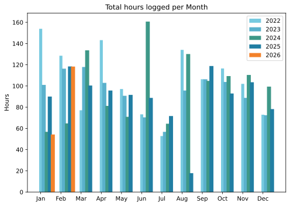
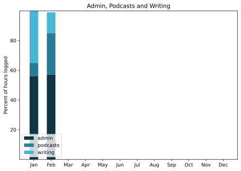

Early because it was a pretty uneventful month, again

===

## Highlights of the month:
- Sweetpea seeds came up like a rocket
- Steady progress migrating websites, backups etc.
- WithKnown is getting some love (and changed its name)
- Met up with a schoolfriend not seen in 55 years
- Good memorial for a good friend
- BirdNET-Pi! and Pi-hole!
- Scored a Chimonanthus for the terrace
- Impressionists from the Detroit Art Institute at the Ara Pacis
- Crocheted a neck thing for The Squeeze
- Warm enough to start working on the plants semi-regularly
- iMac screen is on the bloody fritz.

### Activities

#### February: 
* Walking with sticks: 0
* Reading: 26
* Steps (avge): 7804
* Podcasts: 10 (all of them [logged](https://www.jeremycherfas.net/listens))
* In bed/asleep 7:49/7:40
* Cycled: 0
* Weight (avge): 89.8
* Naps: 11

#### January: 
* Walking with sticks: 0
* Reading: 28
* Steps (avge): 7047
* Podcasts: 16 (all of them [logged](https://www.jeremycherfas.net/listens))
* In bed/asleep 8:19/8:10
* Cycled: 0
* Weight (avge): 89.6
* Naps: 23

### Stuff Done

Continuing to move things over the Hetzner, although I am aware of some reluctance to pull the switch on this, the main site. Can't quite work out why, as I know I have all the failsafe I need in place. Just something seems to make me hesitate. Maybe tomorrow ...

I've also had a bit of success getting ChatGPT to help me automate some little things. If I write a reasonably tight spec that describes plainly what I would like to happen, it often gets there on a first go, and that is helping to automate little tasks so they get done and get done accurately and without errors.

#### Hours logged per month

#### Percent of logged hours

Previous years are still on [an archive page](https://jeremycherfas.net/blog/working-life).

### Goals

Twelve blog posts. Yes, many of them report on disasters recovered from, but this month I think that's OK. 

### Niggles

Hosting remains hard. So is keeping <s>WithKnown</s> Idno up to date now that it is being maintained regularly.

### Final remarks

It's a lot of fun looking at what the BirdNET-Pi was up to while I slept though the dawn chorus, but it would be good to work out some way to summarise and record what's going on. I think a cumulative species graph would be one thing, and a detections per day by weeks. It would have to be automated, somehow. I've got enough manual-till-it-hurts stuff going on.

----

## Here’s the table

Click the triangle to see or hide the table

<table class="worktable">
<thead>
<tr>
<th style="text-align: right;" class="bigrow">Month</th>
<th style="text-align: center;" class="bigrow">Total</th>
<th style="text-align: center;" class="smallrow">Daily</th>
<th style="text-align: center;"class="smallrow">Admin %</th>
<th style="text-align: center;"class="smallrow">ETP %</th>
<th style="text-align: center;"class="smallrow">Writing %</th>
<th style="text-align: center;"class="smallrow">Other %</th>
</tr>
</thead>
<tbody>
<tr>
<td style="text-align: right;">02</td>
<td style="text-align: center;">112.3</td>
<td style="text-align: center;">4.9</td>
<td style="text-align: center;">57</td>
<td style="text-align: center;">28</td>
<td style="text-align: center;">14</td>
<td style="text-align: center;">1</td>
</tr>
<tr>
<td style="text-align: right;">2026-01</td>
<td style="text-align: center;">54.25</td>
<td style="text-align: center;">4.2</td>
<td style="text-align: center;">56</td>
<td style="text-align: center;">9</td>
<td style="text-align: center;">35</td>
<td style="text-align: center;">0</td>
</tr>
</tbody>
</table>

