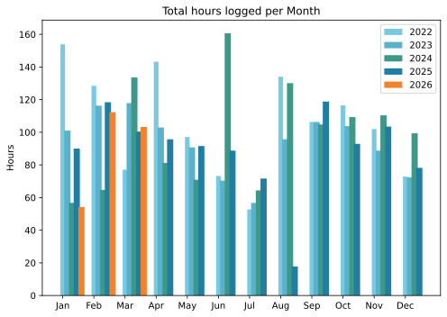
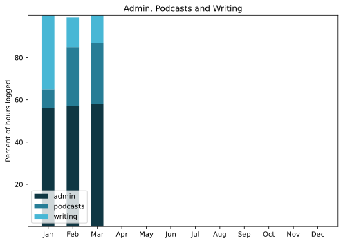

It was a toss-up between working on something a little more substantive or documenting February, and the more mechanical option won.

===

## Highlights of the month:
- Warm, cold, warm, cold. What's a poor seedling to do?
- Tweaked my backup strategy to let Hetzner take care of more
- Splendid return visit to Naples, including Oplontis
- Forked over the big bucks for a new iMac screen
- Installed Compass on Hetzner and it works, and well
- Brief outing to Umbertide on the Tiber
- First bicycle ride in a long time
- Liberated a lot of books from Kindle; will I ever reread them?
- Good exhibit on the Ville e Giardini di Roma
- Finished two excellent not-for-podcast books.

### Activities

#### March: 
* Walking with sticks: 2
* Reading: 24
* Steps (avge): 8383
* Podcasts: 14 (all of them [logged](https://www.jeremycherfas.net/listens))
* In bed/asleep 8:11/8:02
* Cycled: 2
* Weight (avge): 90.3
* Naps: 16

#### February: 
* Walking with sticks: 0
* Reading: 26
* Steps (avge): 7804
* Podcasts: 10 (all of them [logged](https://www.jeremycherfas.net/listens))
* In bed/asleep 7:49/7:40
* Cycled: 0
* Weight (avge): 89.8
* Naps: 11

### Stuff Done

No great geeky problems, mostly just keeping an eye on things to make sure they are mostly behaving as expected. The weather has been trying, not unexpectedly so, but somehow always unexpected. A game of wait and see with the seedlings and some of the other plants on the terrace. One wisteria, for example, is out and doing fine, the other has barely budged. 

Noted that my podcast listening is definitely down over the past quarter, most probably as a result of taking up Qi Gong three days a week, which replaces three, possibly more, walks.

Working seriously, though sporadically, on linking from the main site to photos.

#### Hours logged per month

#### Percent of logged hours

Previous years are still on [an archive page](https://jeremycherfas.net/blog/working-life).

### Goals

Seven blog posts, very few of which retail disasters, so that's an increase within the decrease and I'll take it. 

### Niggles

Main niggle right now is that I don't know enough to deploy everything I want to my Hetzner server rather than use the web-hosting package, because some things are so much simpler when I have proper access. Maybe in a while when things have settled down I'll try again to destroy them.

### Final remarks

I failed to do anything with my BirdNET-Pi data, which in itself is nothing new. It does, though, remain a daily treat to see what turned up. Maybe I should do more to promote my posts to the fediverse.

----

## Here’s the table

Click the triangle to see or hide the table

<table class="worktable">
<thead>
<tr>
<th style="text-align: right;" class="bigrow">Month</th>
<th style="text-align: center;" class="bigrow">Total</th>
<th style="text-align: center;" class="smallrow">Daily</th>
<th style="text-align: center;"class="smallrow">Admin %</th>
<th style="text-align: center;"class="smallrow">ETP %</th>
<th style="text-align: center;"class="smallrow">Writing %</th>
<th style="text-align: center;"class="smallrow">Other %</th>
</tr>
</thead>
<tbody>
<tr>
<td style="text-align: right;">03</td>
<td style="text-align: center;">103.3</td>
<td style="text-align: center;">4.75</td>
<td style="text-align: center;">58</td>
<td style="text-align: center;">29</td>
<td style="text-align: center;">13</td>
<td style="text-align: center;">0</td>
</tr>
<tr>
<td style="text-align: right;">02</td>
<td style="text-align: center;">112.3</td>
<td style="text-align: center;">4.9</td>
<td style="text-align: center;">57</td>
<td style="text-align: center;">28</td>
<td style="text-align: center;">14</td>
<td style="text-align: center;">1</td>
</tr>
<tr>
<td style="text-align: right;">2026-01</td>
<td style="text-align: center;">54.25</td>
<td style="text-align: center;">4.2</td>
<td style="text-align: center;">56</td>
<td style="text-align: center;">9</td>
<td style="text-align: center;">35</td>
<td style="text-align: center;">0</td>
</tr>
</tbody>
</table>

